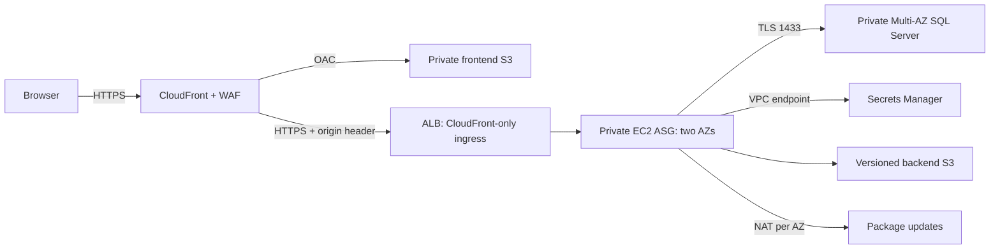

# Architecture and operational controls

## Integrity boundaries

Tenant IDs are validated against JWT claims and the current user/session before executing scoped database operations. Cross-tenant inventory and warehouse references must also be checked inside write transactions; filtering list endpoints alone is insufficient. The database schema and application constraints are complementary boundaries.

Inventory movement, stock balance update, journal posting and audit creation belong to the same SQL transaction. Stock rows are locked by tenant, item, warehouse and bin with update/range locks; underflow rejects the entire transaction. A movement idempotency key protects client retries. Monetary values use SQL fixed-precision decimals; journal entries pair equal debit and credit amounts. Corrections should preserve financial and movement history.

Use catalog unit cost as the valuation basis in this implementation. FIFO/LIFO, weighted-average costing, landed costs, FX revaluation, tax jurisdiction engines, bank reconciliation, consolidation and statutory payroll remittance require additional accounting designs. A directory salary field is not a payroll calculation engine. Do not represent the current modules as those capabilities.

## Identity and sessions

Passwords use unique salts and Node crypto scrypt. Eight-hour HS256 tokens have fixed algorithm, issuer/audience and expiration checks. Authenticated requests require a tenant header. Store browser tokens in memory and serve solely over HTTPS. Provision a strong signing secret outside Git and Terraform variable files. Plan signing-key rotation with session invalidation and customer communication. Global administrators are intentionally privileged across companies; assign that role narrowly.

Application authorization and database permissions are separate. Use a limited SQL runtime identity for production, with a distinct migration identity for schema changes. Verify the deployed identity has no server-level administration rights. A managed RDS master secret is a bootstrap convenience, not a least-privilege application identity.

## Operations

- Centralize structured logs, alert on unhealthy targets, ASG failures, RDS capacity and repeated authorization failures. Never log credentials, JWTs or full request bodies.
- Keep ALB liveness distinct from application/database readiness to prevent mass instance replacement during an RDS failover. Readiness should return a failure status when the database is unavailable.
- Validate SQL backups and point-in-time restores in a separate instance. Multi-AZ availability is not a backup strategy. Define measurable RPO/RTO and test failover.
- Ship versioned immutable backend object keys and verify SHA-256 before extraction. Restrict release upload and instance-refresh permissions to CI deploy roles.
- Use a remote encrypted Terraform state backend with versioning, restricted access and locking. Terraform state contains sensitive infrastructure metadata and origin shared-secret material.
- Limit public origin access with the AWS-managed CloudFront origin-facing prefix list and an origin secret header. TLS certificates must match the configured origin DNS name.
- Apply WAF rate limiting to global traffic and deploy distributed login throttling/identity protection appropriate to the expected traffic. Per-process throttles alone do not impose a fleet-wide limit.
- Review data retention, employee privacy, audit export, incident response and Canadian data residency. CloudFront is a global CDN; do not cache API/HR responses. Review edge logs and telemetry destinations for residency requirements.

## Release gates

Before production: run the SQL integration suite against the target SQL Server version, exercise concurrent stock writes and retries, verify tenant isolation and salary redaction, test RDS failover and restoration, load-test scrypt login capacity and DB pools, scan dependencies/images, validate CDN CSP and caching behavior, and verify certificate/DNS setup in the AWS account. Document owner approval for accounting controls and operating procedures.
